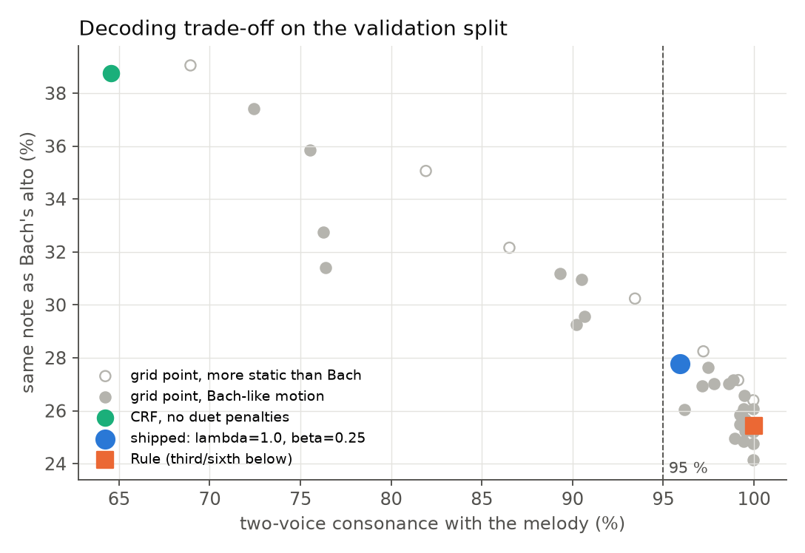
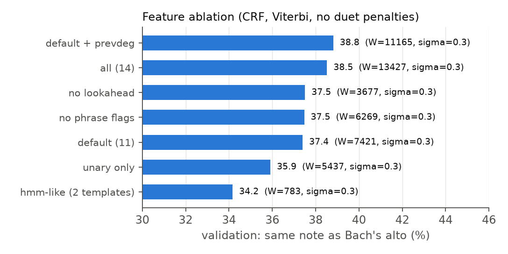
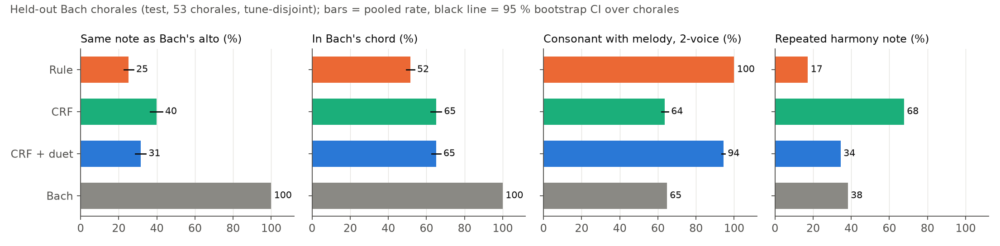
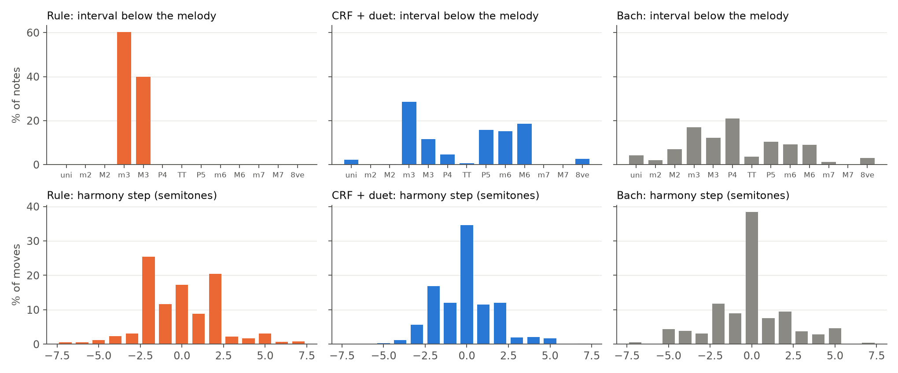
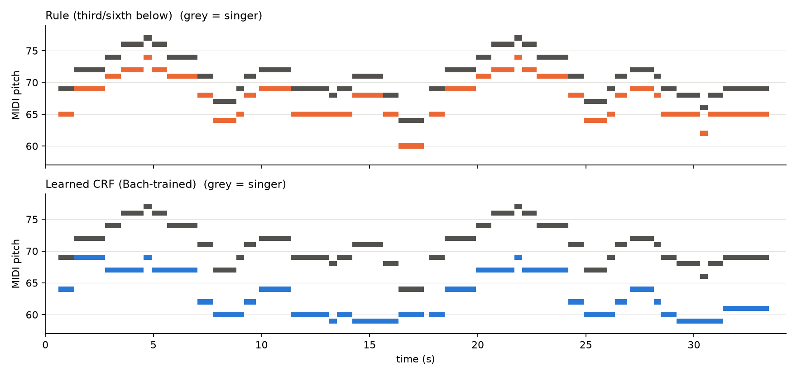

# Learned harmony for Duet: evaluation

**Question.** Can a small model trained on Bach's chorales write a better harmony line than
`follow.plan_harmony`, which always puts a diatonic third (or sixth) below the singer, and still
run instantly at rehearsal time?

**Short answer.** Yes, on chord fit and voice-leading, but not on raw consonance. On 53 held-out
chorales (their tunes never appear in training) the shipped model (CRF + duet decoding):

- puts the harmony note inside Bach's actual chord **65 %** of the time. The rule manages 52 %
  (paired bootstrap difference **+13.5 points, 95 % CI [+10.5, +16.6]**).
- picks Bach's exact alto note **31 %** of the time against the rule's 25 % (**+6.4 [+2.3, +10.1]**).
  The unconstrained CRF reaches 40 %.
- writes no parallel fifths or octaves, no voice crossing, and spaces the voices as Bach does.
  It holds a note about as often as Bach (34 % vs 38 %) instead of moving every note in parallel.
- gives up some two-voice consonance: **94 %** of its notes are consonant against the rule's 100 %.
  The rule is consonant by construction, because it only ever uses 3rds and 6ths. Bach's own
  alto is 65 % consonant in two-voice terms, because he leans on the tenor and bass.

The model runs in **1–2 ms per song** on the MacBook CPU. It has 11,165 weights in a 92 KB file and
trains in 36 s. It is a drop-in replacement: same plan format, same notes kept, and the live
simulation (`run_v0.run_scenario`) runs unchanged with it.

All numbers below come from `results/eval_results.json` (written by `evaluate.py`),
`results/pipeline_results.json`, `results/integration_results.json` and `params/ablation_alto.json`.

---

## 1. Data and split

| | |
|---|---|
| Source | Bach chorales in the music21 corpus, `corpus.chorales.Iterator(numberingSystem='riemenschneider')` (371 entries) |
| Kept | **348** unique four-part chorales. 21 iterator entries are the same file under another Riemenschneider number and were removed. 2 files are not SATB (bwv41.6, bwv27.6) |
| Unit | one example per **soprano note** (ties merged): the alto, tenor and bass pitches sounding at the soprano onset, plus the pitch-class set of the four-voice chord there and a fermata flag |
| Leakage control | Bach often harmonised the same hymn tune several times. Chorales whose soprano lines share ≥ 50 % of their pitch-interval 4-grams (Jaccard, transposition-invariant) are merged with union-find into **231 tune groups**. Whole groups are split 70/15/15 with seed 5160. Example: all seven settings of the Passion chorale tune ("O Haupt voll Blut und Wunden", BWV 244.15/.44/.54/.62, 270, 271, and 248.5) land in one group |
| Split | train **243** chorales / 12,057 notes · val **52** / 2,759 · test **53** / 2,576. The test split is used only in `evaluate.py`. All model choices (features, σ, λ, β) were made on val |
| Input format | each soprano line is converted to the same note dicts that `follow.offline_notes` produces from a recording (`chorales.to_notes`: 0.6 s per quarter, a fermata becomes a 0.2 s breath), so training and run time share one feature path |

## 2. Model

The model is a **linear-chain conditional random field** over the interval
of the harmony voice below the melody (0–16 semitones, 17 states). It is decoded with Viterbi and
written in numpy, trained with scipy L-BFGS.

1. **Key from the melody only.** Krumhansl–Schmuckler correlation using Aarden–Essen profiles,
   with +0.2 added when the last note is the candidate tonic. The profile and bonus were chosen on
   the *training* split. Agreement with music21's full-score key:

   | | val | test |
   |---|---|---|
   | `follow.detect_key` (Krumhansl–Kessler profile) | 76.9 % | 64.2 % |
   | `model.detect_key_melody` (Aarden–Essen + final-tonic bonus) | **86.5 %** | **83.0 %** |

2. **Normalisation.** The melody is transposed so the tonic becomes C (taking the shorter
   direction), then shifted by octaves into Bach's soprano register. The result is transposed back
   afterwards, so a baritone singing an octave lower gets the same line an octave lower (unit test).
3. **Features (12 templates, 11,165 weights).** All are computable from a live singer's notes:
   - **Unary.** Interval given scale degree and mode, interval class given phrase end / phrase
     start / note length / next degree / previous degree, and the absolute register of the harmony
     note.
   - **Pairwise.** Harmony step given melody step, interval-class pair given melody direction
     (this is where parallel fifths are learned), harmony-degree pair given mode, interval pair,
     and harmony step given previous harmony degree (leading-tone resolution).
   - A phrase end is a breath (gap ≥ 100 ms) or the last note. Meter is **not** used, because a
     live singer's notes carry no bar lines.
4. **Training.** Maximise conditional log-likelihood with an L2 prior (σ = 0.3, chosen on val).
   Positions where the alto rests or lies outside 0–16 semitones (0.44 %) are left unlabelled and
   marginalised, so no chorale is dropped. The gradient was checked against finite differences, and
   log Z against brute-force enumeration.
5. **Duet decoding.** Bach writes for four voices; Duet has two. At decoding time three terms are
   added to the learned scores:
   - a **hard ban** on parallel perfect fifths and octaves with the melody;
   - **λ** × a penalty on intervals that are dissonant in two voices (2nds, P4, tritone, 7ths),
     weighted ×1.5 on long notes and +1 at phrase ends;
   - **β** × a penalty for holding the previous harmony note. This one is needed because MAP
     decoding over-produces the single most likely move, which is "hold": the unconstrained CRF
     holds 68 % of notes on test against Bach's 38 %.

   λ and β were set on **validation** by two product requirements: (i) at least 95 % two-voice
   consonance, and (ii) no more held notes than Bach's own alto (37.2 % on val). Among the settings
   that meet both, the one closest to Bach was taken: **λ = 1.0, β = 0.25**
   (val: 27.8 % exact, 95.9 % consonant, 34.5 % held).



### Feature ablation (validation, exact alto %, Viterbi with no duet terms)

| feature set | weights | σ = 0.1 | σ = 0.3 |
|---|---|---|---|
| HMM-like (interval given degree + harmony step given melody step) | 783 | 34.0 | 34.2 |
| unary only | 5,437 | 35.0 | 35.9 |
| default (11) | 7,421 | 37.3 | 37.4 |
| default without look-ahead (next degree) | 3,677 | 36.7 | 37.5 |
| default without phrase flags | 6,269 | 36.8 | 37.5 |
| all (14) | 13,427 | 37.9 | 38.5 |
| **default + previous degree (shipped)** | **11,165** | 36.8 | **38.8** |

σ = 1.0 was tried on the first three sets and never beat σ = 0.3
(`results/ablation_partial_sigma_grid.log`). Each val accuracy has a standard error of about
0.9 points (2,758 notes). Differences between the top four sets are therefore within noise. The
clear effects are that pairwise terms help (+2.9 over unary only) and that the richer CRF beats
the two-factor HMM (+4.6).



## 3. Test results (53 held-out chorales, 2,576 melody notes)

Rates are pooled over all notes. Ranges are 95 % bootstrap CIs, resampling whole chorales (2,000
resamples). "Exact" is measured against Bach's alto at the soprano onset (2,563 labelled notes).
Definitions are in `metrics.py`.

| generator | exact alto % | in Bach's chord % | consonant 2-voice % | consonant incl. P4 % | par. 5ths /100 | par. 8ves /100 | crossing % | S–A > 8ve % | outside G3–D5 % | mean step (st) | leaps > M3 % | leaps > P5 % | held % |
|---|---|---|---|---|---|---|---|---|---|---|---|---|---|
| Rule (`follow.plan_harmony`) | 25.1 [22.7, 27.7] | 51.6 [49.5, 53.6] | **100.0** | 100.0 | 0 | 0 | 0 | 0 | 0.8 | 1.86 | 7.3 | 0.4 | 17.2 |
| Unigram counts | 32.5 [29.9, 35.0] | 57.5 | 50.9 | 89.7 | 0 | 0 | 0 | 0 | 0.4 | 1.87 | 15.7 | 1.1 | 45.1 |
| Count HMM + Viterbi | 32.6 [29.8, 35.4] | 56.2 | 58.1 | 89.9 | 0.16 | 0 | 0 | 0 | 0 | 0.72 | 10.2 | 0.2 | 81.5 |
| CRF (Bach style, λ=β=0) | **39.8** [36.5, 42.8] | **65.1** [62.4, 67.7] | 63.6 | 90.6 | 0 | 0 | 0 | 0 | 0.04 | 0.83 | 7.3 | 0.4 | 67.7 |
| **CRF + duet (shipped)** | 31.4 [28.8, 34.2] | **65.1** [62.7, 67.4] | 94.3 [93.5, 95.1] | 99.0 | **0** | **0** | 0 | 0.1 | 0.4 | 1.32 | 2.6 | 0.4 | 34.4 |
| CRF + duet, oracle key | 30.9 | 65.4 | 94.7 | 99.1 | 0 | 0 | 0 | 0.1 | 0.3 | 1.34 | 2.6 | 0.4 | 33.6 |
| Bach (reference) | 100 | 100 | 64.7 | 85.8 | 0.04 | 0.04 | 0.08 | 0.5 | 0 | 1.64 | 10.6 | 0.6 | 38.3 |

Paired bootstrap against the rule, as difference in points with 95 % CI and the share of
resamples ≤ 0:

| | exact alto | in Bach's chord | two-voice consonance |
|---|---|---|---|
| CRF (Bach style) − Rule | +14.7 [+10.7, +18.5], p ≈ 0 | +13.6 [+9.9, +16.8], p ≈ 0 | −36.4 [−38.1, −34.5] |
| **CRF + duet − Rule** | **+6.4 [+2.3, +10.1]**, p = 0.001 | **+13.5 [+10.5, +16.6]**, p ≈ 0 | −5.7 [−6.5, −4.9] |



How to read this:

- **"In Bach's chord"** is the most meaningful number for a duet. It asks whether the machine's note
  belongs to the harmony a master would put under that melody note. The duet constraints cost
  nothing here (65.1 vs 65.1); what they give up is exact agreement on which chord tone Bach chose.
- **Interval mix.** The rule uses only m3/M3 below. The learned line spreads over 3rds, 5ths and
  6ths, with occasional unisons and octaves (4.8 %), which is closer to Bach's distribution (see
  figure). Its motion is mostly steps and held notes, with fewer leaps than either Bach or the rule.
- **Key errors cost little.** The oracle key changes the result by under 1 point. Of the 9 test
  chorales whose key is mis-detected, 6 are relative major/minor confusions, which share the same
  scale; the other 3 are a fourth or fifth away.



## 4. Through the real rehearsal front end (`pipeline_eval.py`)

Each test soprano was sung by the synthetic singer (glides, vibrato, ±0.1 st intonation, breaths),
then passed through `follow.analyse` → `follow.offline_notes`, exactly as a rehearsal recording
would be. Both planners then ran on the *estimated* notes.

- Segmentation found 100 % of score onsets within 80 ms, with the correct pitch on 99.8 %.
- Learned (shipped): 31.4 % exact, 65.0 % in chord, 94.4 % consonant, 0 parallels.
- Rule: 25.1 % exact, 51.6 % in chord, 100 % consonant.

The test-set result therefore carries through the actual Duet input path. The singer is synthetic,
however; see the limitations section.

## 5. Plug-in check with the live engine (`integration_check.py`)

`run_v0.run_scenario` ran on the synthetic Greensleeves with the `natural` and `pause` scenarios,
once with the rule plan and once with the learned plan.

- Timing is identical: predictive median |async| 10.8 ms / 11.5 ms, 26 notes played, 0 wrong.
- The plan's onsets drive the Accompanist and the pitches do not, so this confirms format
  compatibility. It is not a timing improvement.

## 6. Listening example: Greensleeves (`examples/`)

Notes come from the real rehearsal path (`singer.render` → `analyse` → `offline_notes`): 37 of 37
notes recovered, all at the correct pitch. Both planners detect A minor.

| file | content |
|---|---|
| `examples/greensleeves_rule.wav` | singer + rule harmony (34 s, 24 kHz mono) |
| `examples/greensleeves_learned.wav` | singer + learned harmony |
| `examples/harmony_rule.wav`, `examples/harmony_learned.wav` | machine voice only |
| `examples/greensleeves_compare.musicxml` | melody + both lines in 3/4, opens in MuseScore / Sibelius / music21 |
| `examples/plans.json` | both plans |



The rule line is the melody shifted down a third throughout. The learned line moves more slowly and
outlines chords:

- **First phrase:** under the D–E–F–E–D bar it sits on G and A, and under G–A–B on C–C–D. My
  reading is that this implies the G-major (VII) and C-major (III) chords of the usual
  Am–C–G–Em accompaniment of this tune; that is a hand analysis, not a measured result.
- **Ending:** it closes with a Picardy third (C#4 under the final A4). Bach often ends minor-key
  chorales this way, and it is a common choice in Greensleeves arrangements.

On this tune the learned line is 97 % consonant, has 0 parallels and holds 31 % of notes. The rule
holds 14 %.

## 7. Speed and size

| | |
|---|---|
| Plan for Greensleeves (37 notes) | 1.3 ms |
| Plan for the longest test chorale (101 notes) | 2.0 ms |
| Training (243 chorales, L-BFGS, 97 iterations) | 36 s, CPU |
| Parameters | 11,165 floats, `params/crf_alto.npz` = 92 KB |
| Dependencies | numpy at run time. scipy and music21 are needed for training only |

Timings are means of 20 runs on this MacBook, measured inside `evaluate.py`.

## 8. Limitations and what is NOT verified

- **No listening test.** I could not play audio in this environment, so I have not heard the wav
  files. Every quality claim above is a symbolic proxy. A small blind A/B test (rule vs learned,
  5–10 listeners) is the obvious next step and is not done.
- **The style target is a choice.** "Close to Bach" (exact alto, chord tones) and "sounds good as a
  duet" (two-voice consonance) pull in opposite directions; see the trade-off figure. The 95 % /
  Bach-hold-rate thresholds that set λ and β are my product judgement, not a measured preference.
- **Domain shift.** The training data is 18th-century Lutheran chorales. Pop or folk melodies with
  chromaticism, modulation or blue notes are out of distribution. The key detector also assumes the
  song ends on its tonic, which is true for chorales and Greensleeves but not always.
- **No meter.** Bach's harmonic rhythm depends on the beat; the model sees only note lengths and
  breaths.
- **Exact-alto accuracy is a strict metric.** Many different altos are correct. 31–40 % agreement
  should be read as relative evidence, not as an error rate.
- **Synthetic singer only** for the front-end test (§4). Real voices (scoops, vibrato, consonants)
  have not been tested here; that belongs to `eval/`.
- **Model selection noise.** The differences between the top feature sets are within one standard
  error on val.
- The Aarden–Essen **minor** profile has unclear provenance: music21's documentation says so and
  recommends it for major keys. It still won on the training split.
- **Other voices.** Tenor and bass state ranges are coded (`train.py --voice tenor|bass`) but have
  not been trained or evaluated.

## 9. Reproduce

```bash
cd project/duet_v0
.venv/bin/python harmony/chorales.py         # parse corpus -> data/bach_satb.json (~70 s)
.venv/bin/python harmony/dataset.py          # tune-grouped split -> data/split.json
.venv/bin/python harmony/ablation.py         # feature sets x sigma on val (~6 min)
.venv/bin/python harmony/train.py --feature-set "default + prevdeg" --sigmas 0.3
.venv/bin/python harmony/evaluate.py         # val sweep of lambda/beta, test metrics (~5 s)
.venv/bin/python harmony/pipeline_eval.py    # synthetic singer -> offline_notes -> plans (~75 s)
.venv/bin/python harmony/integration_check.py
.venv/bin/python harmony/make_examples.py
.venv/bin/python harmony/report.py           # figures
.venv/bin/python -m unittest discover -s harmony/tests -v
```

## References (opened while doing this work)

- M. Allan, C. K. I. Williams, "Harmonising Chorales by Probabilistic Inference", NIPS 2004. HMMs
  trained on Bach chorales, the closest prior work:
  https://proceedings.neurips.cc/paper/2004/hash/b628386c9b92481fab68fbf284bd6a64-Abstract.html
- music21 chorale corpus (`ChoraleList` / `Iterator`, Riemenschneider numbering, shared titles):
  https://www.music21.org/music21docs/moduleReference/moduleCorpusChorales.html
- music21 `analysis.discrete` (Aarden–Essen, Temperley–Kostka–Payne, Krumhansl key profiles):
  https://www.music21.org/music21docs/moduleReference/moduleAnalysisDiscrete.html
- M. Feezell, "SATB Part-writing 1: Voicing Triads", LearnMusicTheory.net. Voice order, an octave
  or less between S and A, alto range G3–D5:
  https://learnmusictheory.net/PDFs/pdffiles/02-05-SATBPartWriting1VoicingTriads.pdf
